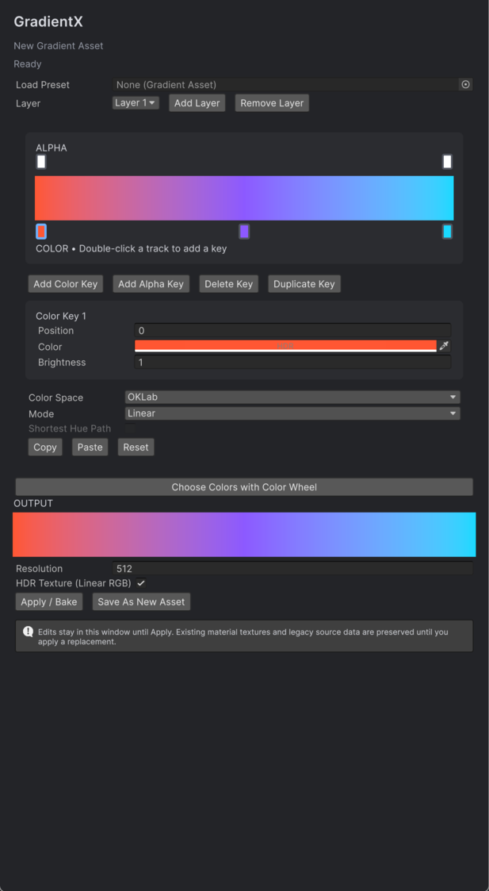
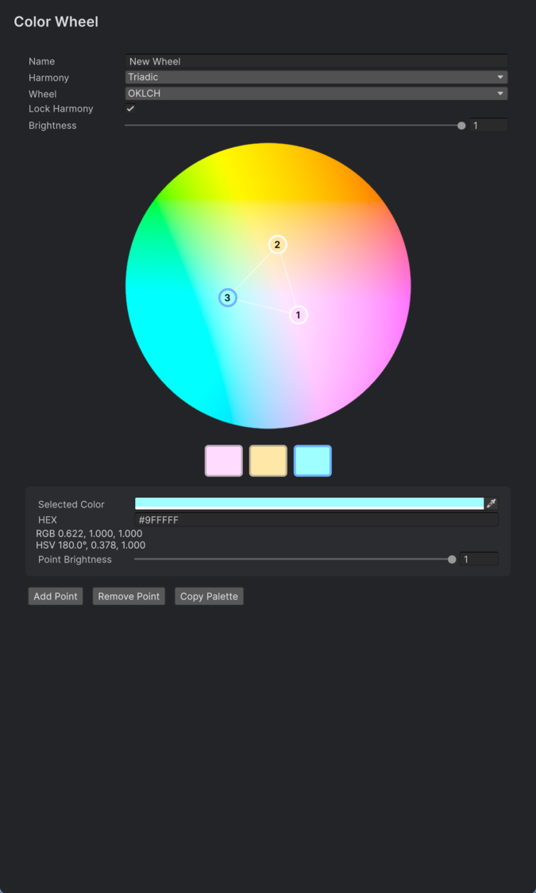

# Color Harmony

Color conversion, gradient assets, color harmony tools, and a custom material Inspector for Unity.

**Package:** `com.xorfe.colorharmony` · **Version:** `0.3.1` · **Unity:** `2022.3+` · **License:** MIT

---

## Installation

In Unity Package Manager, select **Add package from git URL**:

```text
https://github.com/xOrfe/ColorHarmony.git
```

> **Note:** Pin a specific commit (`#<commit-sha>`) for reproducible builds. Core runtime and editor have no render pipeline dependencies; optional Shader Graph subgraphs and URP Lit/Unlit adapters are detected automatically.

---

## Features

### GradientX
Open via **Window > Color Harmony > GradientX** or by clicking **Edit GradientX** on any serialized `GradientX` field.

- **Color Spaces:** Interpolate in RGB, HCV, HCY, HSL, HSV, OKLab, xyY, XYZ, or YCbCr.
- **Modes:** Step, Linear Interpolation, and Circular Wrap (`InterpolateCircle` with shortest hue path).
- **Tracks & HDR:** Independent linear alpha track, HDR color support, and brightness multiplier.
- **Baking:** Bake linear textures (2 to 4096 px, RGBAHalf / RGBA32) as standalone `GradientAsset` files or assign directly to materials.
- **Editor Support:** Full Undo/Redo, prefab overrides, and palette importing.

### Color Wheel
Open via **Window > Color Harmony > Color Wheel** or from a `ColourWheel` field.

- **Color Models:** Standard (HSV) and perceptual OKLCH.
- **Harmony Modes:** Classic rules (Complementary, Triadic, Analogous, etc.) with locked rotation around an anchor point, or Custom mode (up to 8 points).
- **Export & Sync:** Copy HEX palettes directly to clipboard or use **Send Palette to GradientX** to distribute points evenly across gradient keys.

---

## Previews




---

## Harmonica (Material Inspector)

Harmonica enhances Unity's Material Inspector for Shader Graph and standard materials.

1. In your Shader Graph's Graph Inspector, set **Custom Editor GUI** to `Harmonica` (or `XO.ColorHarmony.Editor.Harmonica`).
2. Add a `Texture2D` property named `[Gradient] Ramp` (e.g. `_Ramp`).
3. Click **Create / Migrate GradientX** or **Edit GradientX** on the material to edit and bake textures directly.
4. Sample the texture at UV `(t, 0.5)` in your shader.

### Property Tags

| Tag | Target | Description |
| --- | --- | --- |
| `[Gradient]` | `Texture2D` | Displays preview and opens GradientX editor/baker |
| `[ToggleFoldout]` | `Float` / `Range` | Toggleable header with collapsible child section |
| `[sub]` | Any | Groups property under current depth-0 foldout |
| `[sub2]`, `[sub3]` | Any | Nested foldout levels |

---

## Runtime API

```csharp
using UnityEngine;
using XO.ColorHarmony;

public class GradientExample : MonoBehaviour
{
    [SerializeField] private GradientX gradient = new GradientX();
    [SerializeField] private GradientAsset bakedAsset;

    public Color Evaluate(float t) => gradient.Evaluate(t);

    public Color[] SampleBatch(int count)
    {
        var pixels = new Color[count];
        // CreateSnapshot avoids re-sorting/allocations on repeated sampling
        gradient.CreateSnapshot().Sample(pixels);
        return pixels;
    }

    public Texture2D Texture => bakedAsset != null ? bakedAsset.BakedTexture : null;
}
```

- **Color Conversions:** Use `ColorX.Convert(color, fromSpace, toSpace)`, `FromRgb`, and `ToRgb` across 9 color spaces.
- **Shaders:** Runtime HLSL include files are located at `Runtime/Shaders/ColorConversions.hlsl`. Reusable subgraphs are included under `Runtime/ShaderGraph/`.

---

## Samples & Tests

- **Sample:** Import **Getting Started** via Package Manager > Color Harmony > Samples.
- **Tests:** Add `com.xorfe.colorharmony` to `testables` in `manifest.json` and run the suite via Unity Test Runner.

## Documentation

- [LICENSE](LICENSE) – MIT License.
